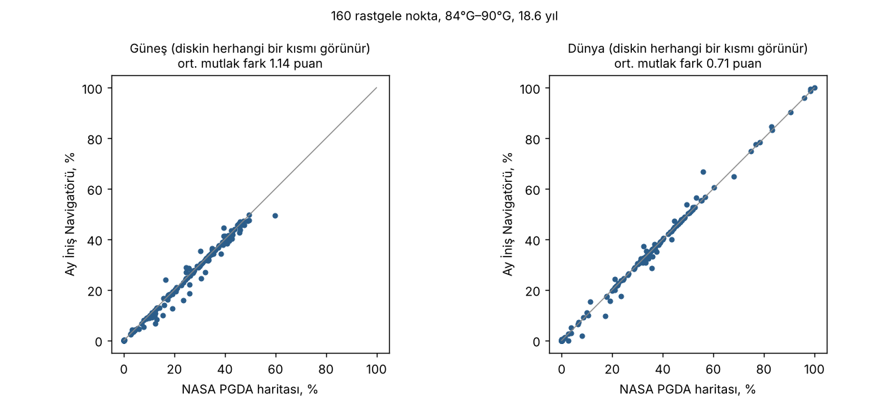

# Doğrulama: NASA ortalama görünürlük haritaları ile karşılaştırma

Tarih: 14 Kasım 2026 · Betik: `scripts/03_dogrulama.py` · Sonuçlar: `dogrulama.json`, `dogrulama.png`

## Ne karşılaştırıldı

NASA'nın LOLA ekibi, kutup bölgeleri için 18.6 yıllık (bir Ay nütasyon döngüsü), saatlik
adımlı ortalama görünürlük haritaları yayımlıyor (PGDA ürün 69, sürüm 201608):

- `AVGVISIB_75S_120M_201608.TIF`: Güneş diskinin herhangi bir kısmının görünme oranı
- `AVGVISIB_75S_120M_201608_EARTH.TIF`: Dünya diskinin herhangi bir kısmının görünme oranı

Bizim yöntemimiz aynı koşullara yaklaştırılarak çalıştırıldı:

- 160 rastgele nokta, 84°G–90°G, eğimi 10°'den az (tohum 20261114)
- 2010-01-01 – 2028-08-08 (18.6 yıl), 3 saat adım
- Güneş ve Dünya disk olarak: herhangi bir kısmı arazinin üstündeyse "görünür"
- Gözlemci yüzeyde (0 m); ayrıca uygulamadaki 2 m gözlemci için de

## Sonuç

| | Gözlemci | Ortalama mutlak fark | Ortalama fark (biz − NASA) | En büyük fark | Korelasyon |
|---|---|---|---|---|---|
| Güneş | 0 m | 1.14 puan | −0.60 puan | 10.3 puan | 0.990 |
| Dünya | 0 m | 0.71 puan | −0.05 puan | 11.0 puan | 0.997 |
| Güneş | 2 m | 1.77 puan | −1.19 puan | 8.0 puan | – |
| Dünya | 2 m | 0.81 puan | +0.66 puan | 17.3 puan | – |

## Yorum

- NASA'nın Güneş haritası, Güneş diskinin herhangi bir kısmının göründüğü zamanı gösteriyor.
  Diskin ortalama görünen kesriyle (enerji oranı) karşılaştırınca fark 2.54 puana çıkıyor.
  Haritanın tanımı bu yüzden "herhangi bir kısmı" olarak alındı.
- İki yöntem çoğu noktada 1–2 puan içinde uyuşuyor. Tek tük büyük farklar dik krater
  kenarlarında görülüyor. Orada ufuk çözünürlüğe çok duyarlı: biz 80 m, NASA 120 m DEM
  kullanıyor, DEM sürümleri de farklı (2023'e karşı 2016).
- Uygulamadaki rakamlar 2 m gözlemci içindir ve haritalardan biraz farklı olmaları beklenir.
